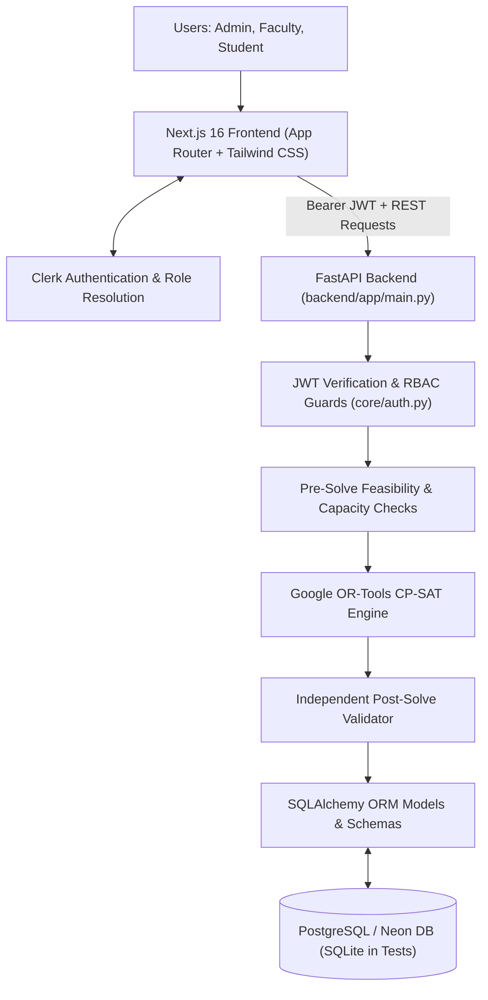

# OptiSched – AI-Driven Automated Constraint-Based Academic Timetable Generation System


**OptiSched** is a full-stack academic operations and automated timetable generation platform developed as a B.Tech capstone project at **Alliance University, Bengaluru**. It models institutional timetabling as a Constraint Satisfaction and Optimization Problem (CSOP) using **Google OR-Tools CP-SAT**, paired with a **FastAPI** backend, **PostgreSQL (Neon)** persistence, **Clerk** role-based authentication, and a **Next.js** web interface for Administrators, Faculty, and Students.

---

## Table of Contents

- [Introduction](#introduction)
- [Problem Statement & Objectives](#problem-statement--objectives)
- [Implemented vs. Planned Features](#implemented-vs-planned-features)
- [Optimization Methodology](#optimization-methodology)
- [System Architecture](#system-architecture)
- [Technology Stack](#technology-stack)
- [Project Structure](#project-structure)
- [Installation & Setup (Windows)](#installation--setup-windows)
- [Running Tests & Frontend Checks](#running-tests--frontend-checks)
- [Development Progress](#development-progress)
- [Roadmap](#roadmap)
- [Project Information](#project-information)

---

## Introduction

Academic timetable preparation requires coordinating multiple interdependent resources simultaneously:

- **Subjects** with distinct weekly period counts and theory/laboratory requirements.
- **Faculty members** with specific subject qualifications and day/time availability windows.
- **Student sections** grouped by department, academic year, semester, and enrollment count (`student_count`).
- **Classrooms and laboratories** with room type classifications and seating capacities.
- **Academic sessions** governed by working hours, period durations, transitions, and break/lunch windows.
- **Institutional scheduling rules** that prohibit simultaneous double-bookings and ineligible assignments.

Manual scheduling in spreadsheets or ad-hoc tools becomes error-prone and time-consuming as departments, shared faculty, and lab bottlenecks grow. OptiSched automates timetable construction using exact constraint programming and verifies every generated schedule with an independent post-solve validator before publication.

---

## Problem Statement & Objectives

### Problem Statement

University departments must generate conflict-free weekly timetables across multiple semesters while respecting room capacities, laboratory equipment requirements, faculty subject qualifications, faculty unavailability periods, and configurable semester daily timings. Manual conflict resolution frequently introduces hidden overlaps, room capacity mismatches, or infeasible schedules discovered late in the academic cycle.

### Motivation & Main Objectives

1. **Automate Conflict-Free Scheduling:** Formulate academic timetabling as a mathematical CP-SAT model that eliminates section, faculty, and room overlaps by construction.
2. **Enforce Domain & Resource Constraints:** Validate faculty-subject eligibility, lab-vs-lecture room matching, section seat capacity against room capacity, and faculty blocked time intervals.
3. **Provide Actionable Diagnostics:** Detect capacity deficits, missing room types, or infeasible constraint combinations early with clear HTTP error diagnostics.
4. **Verify Every Schedule Independently:** Run a deterministic post-solve interval validator across all generated and published timetables.
5. **Deliver Role-Specific Portals:** Provide dedicated web workflows for Administrators (configuration, CRUD, generation, publishing), Faculty (personal schedules and availability visibility), and Students (published section timetables).

### Expected Outcomes

- Reproducible, mathematically verified academic timetables generated in seconds for feasible datasets.
- Persistent published timetable versions accessible to faculty and students.
- A modular foundation prepared for comparative metaheuristic research (Genetic Algorithm and Simulated Annealing alongside CP-SAT).

---

## Implemented vs. Planned Features

### Implemented Features (Verified in Codebase)

- **Role-Based Portals & Clerk Authentication:**
  - Server-side Clerk session verification and deterministic role mapping (`admin`, `faculty`, `student`) in `optisched/lib/auth-role.ts`, `optisched/app/api/auth/me/route.ts`, and `backend/app/core/auth.py`.
  - Dedicated portal routes: `/admin`, `/faculty`, `/student`, `/sign-in`, `/sign-up`, and `/unauthorized`.
  - FastAPI dependency guards (`require_admin`, `require_authenticated`) returning `401` for missing/invalid tokens and `403` for unauthorized roles.
- **Academic Data Management (CRUD & Bulk CSV Import):**
  - Full backend endpoints and Admin UI (`AcademicDataManagement.tsx`, `FacultyManagement.tsx`, `CurriculumManagement.tsx`, `TimetableSettings.tsx`) for managing **Sections**, **Subjects**, **Faculty**, **Faculty–Subject Qualifications**, **Rooms**, **Course Offerings**, and **Semester Timetable Configurations**.
  - Bulk CSV preview and commit pipeline (`/api/import/csv`) plus overview metrics (`/api/academic-data/overview`).
- **Student Count & Room Capacity Enforcement:**
  - `student_count` field on `ClassSection` (`backend/app/models/classes.py`), validated as a positive integer (`1..500`).
  - CP-SAT candidate-room filtering ensures rooms with `capacity < section.student_count` are excluded and reports descriptive `400` errors when no suitable room exists.
- **Faculty Day/Time Availability Management:**
  - `FacultyAvailability` database model (`backend/app/models/faculty_availability.py`) and CRUD APIs (`/api/faculty-availability`, `/api/faculty/{faculty_id}/availability`).
  - Admin management controls in `FacultyManagement.tsx` and availability display in `FacultyClientView.tsx`.
  - Unavailable intervals are enforced as hard CP-SAT exclusions (`model.Add(var == 0)`) and verified post-solve.
- **CP-SAT Timetable Generation & Independent Validation:**
  - `/api/timetable/generate` constructs continuous-time exclusivity constraints and optimizes daily distribution using `ortools.sat.python.cp_model`.
  - `_validate_generated_schedule()` independently verifies continuous-time interval overlaps, room type eligibility, faculty qualifications, seating capacity, and faculty unavailable windows.
- **Multi-View Timetable Display, Export & Persistent Publishing:**
  - Section-wise, faculty-wise, and room-wise timetable views (`GET /api/rooms/{room_id}/schedule` and Admin view-mode switcher).
  - Persistent timetable publishing and version history (`PublishedTimetable`, `PublishedTimetableEntry`, `/api/timetable/publish`, `/api/timetable/published`, `/api/timetable/published/latest`, `/api/timetable/published/{id}`), rejecting schedules with any validation clash.
  - CSV schedule export in the UI.
- **Authentication Security & Automated Test Suite:**
  - Bcrypt password hashing with strict hash-prefix checks (`backend/app/core/security.py`), 26-character ULID user IDs (`backend/app/core/ulid.py`), environment-driven demo seeding (`backend/seed_demo_accounts.py`), and **34 passing `unittest` cases**.

### Planned Features (Not Yet Implemented)

- **Soft-Constraint Optimization Extensions:** Weighted preferences for faculty gap minimization, consecutive class limits, preferred teaching windows, and room-change reduction.
- **Genetic Algorithm (GA) Solver:** Evolutionary timetable generator for comparative benchmarking.
- **Simulated Annealing (SA) Solver:** Local-search metaheuristic timetable generator for comparative benchmarking.
- **Algorithm Performance Comparison:** Controlled empirical benchmarking comparing CP-SAT, GA, and SA across solve latency, feasibility rate, and soft-constraint scores.
- **Advanced Reporting & Deployment Automation:** Utilization analytics dashboards, Alembic revision workflows, and CI/CD deployment pipelines.

---

## Optimization Methodology

OptiSched uses **Google OR-Tools CP-SAT** (`cp_model.CpModel` and `cp_model.CpSolver` in `backend/app/main.py`) with boolean decision variables `x_{lesson, slot, room}` representing whether a lesson occurrence is assigned to a specific time slot and eligible room.

### Hard Constraints Enforced

1. **Single Assignment per Lesson:** Every required weekly lesson occurrence is scheduled exactly once (`model.AddExactlyOne`).
2. **Section Exclusivity:** A student section attends at most one lesson in any time slot (`model.AddAtMostOne`).
3. **Faculty Exclusivity (Continuous-Time):** Using sweep-line event intervals over `(faculty_id, day)`, a faculty member cannot teach overlapping time intervals (`sum(active_vars) <= 1`).
4. **Classroom Exclusivity (Continuous-Time):** Using sweep-line event intervals over `(room_id, day)`, a room cannot host overlapping sessions (`sum(active_vars) <= 1`).
5. **Faculty Subject Qualification:** Offerings and solver pre-checks ensure assigned faculty are qualified for the subject when qualification mappings exist.
6. **Classroom Suitability & Capacity:** Lab subjects are restricted to `lab` rooms, theory subjects to non-lab classrooms/lecture halls, and rooms must satisfy `room.capacity >= section.student_count`.
7. **Faculty Availability Blackouts:** Decision variables overlapping a faculty member's blocked `FacultyAvailability` interval (`is_available=False`) are fixed to `0` (`model.Add(var == 0)`).

### Objective Function & Solver Statuses

- **Objective:** Minimizes the maximum daily session load per section (`30 * max_daily_var`) summed with an early-period tie-breaker (`(slot_index + 1) * var`) to balance weekly workloads evenly.
- **Handled Solver Statuses:**
  - `OPTIMAL` / `FEASIBLE`: Constructs the schedule, runs `_validate_generated_schedule()`, and returns the solution with `solve_time_seconds` and validation summary.
  - `INFEASIBLE`: Returns HTTP `409` explaining that constraints cannot be satisfied simultaneously.
  - `UNKNOWN`: Returns HTTP `409` when `max_time_seconds` expires before a feasible solution is found.
  - `MODEL_INVALID`: Returns HTTP `409` reporting invalid model construction.
- **Comparative Research Note:** Genetic Algorithm and Simulated Annealing solvers are planned for Phase 3 comparative evaluation; no comparative benchmark claims are made prior to implementation.

---

## System Architecture



---

## Technology Stack

| Layer | Technologies Verified in Repository |
| :--- | :--- |
| **Frontend** | Next.js `16.4.3`, React `19.3.0`, TypeScript `^5`, Tailwind CSS `^4`, `@base-ui/react`, `lucide-react` |
| **Authentication** | `@clerk/nextjs` `^7.9.14`, `clerk-backend-api`, `bcrypt`, `python-ulid` |
| **Backend API** | Python `3.13`, FastAPI, Uvicorn, Pydantic (`EmailStr`, `BaseModel`) |
| **Optimization** | Google OR-Tools (`ortools.sat.python.cp_model`) |
| **Database & ORM** | PostgreSQL (Neon serverless), SQLAlchemy, `pg8000`, `python-dotenv`, Alembic (installed; idempotent Python migration scripts currently active) |
| **Testing & Lint** | Python `unittest` + FastAPI `TestClient`, ESLint `^9` (`eslint-config-next`), TypeScript (`tsc --noEmit`) |

---

## Project Structure

```text
CAPSTONE_PROJECT/
├── DESIGN.md                           # Canonical UI/design specification
├── PRODUCT.md                          # Product scope and accessibility principles
├── README.md                           # Project documentation
├── .env.example                        # Root Neon database template variables
├── backend/
│   ├── .env.example                    # Backend env template (DB, Clerk, demo seed vars)
│   ├── requirements.txt                # Python dependencies
│   ├── migrate_phase2.py               # Phase 2 schema migration (student_count, availability, publishing)
│   ├── migrate_to_ulid.py              # Users primary-key migration to 26-char ULID
│   ├── migrate_to_snowflake.py         # Historical 64-bit Snowflake ID migration script
│   ├── seed_demo_accounts.py           # Env-driven demo account seeder (bcrypt)
│   ├── app/
│   │   ├── main.py                     # FastAPI routes, CP-SAT solver, independent validator
│   │   ├── core/
│   │   │   ├── auth.py                 # Clerk JWT validation & RBAC dependencies
│   │   │   ├── security.py             # Bcrypt password hashing & verification
│   │   │   ├── ulid.py                 # Crockford Base32 ULID generator/validator
│   │   │   └── snowflake.py            # 64-bit Snowflake ID generator
│   │   ├── db/
│   │   │   └── session.py              # SQLAlchemy engine, Neon/SQLite session config
│   │   ├── models/                     # User, Faculty, ClassSection, Subject, Room,
│   │   │                               # CourseOffering, FacultySubject, TimetableConfig,
│   │   │                               # FacultyAvailability, PublishedTimetable(+Entry)
│   │   └── schemas/
│   │       └── user.py                 # Pydantic user request/response schemas
│   └── tests/
│       ├── conftest.py                 # Shared test environment setup
│       ├── test_academic_crud.py       # CRUD, CSV import, and CP-SAT generation tests
│       ├── test_auth.py                # Auth, RBAC, bcrypt, ULID, and seed validation tests
│       └── test_phase2.py              # Capacity, availability, room schedule, publish tests
├── optisched/
│   ├── .env.example                    # Frontend env template (API URL & Clerk keys)
│   ├── package.json                    # Next.js scripts and dependencies
│   ├── next.config.ts                  # Next.js configuration
│   ├── eslint.config.mjs               # ESLint configuration
│   ├── proxy.ts                        # Clerk Next.js middleware
│   ├── app/
│   │   ├── admin/                      # Admin portal (dashboard, CRUD, solver, publish)
│   │   ├── faculty/                    # Faculty portal (personal schedule & availability)
│   │   ├── student/                    # Student portal (published section timetables)
│   │   ├── api/auth/me/route.ts        # Authenticated role inspection endpoint
│   │   ├── sign-in/, sign-up/          # Clerk auth pages
│   │   └── unauthorized/               # Role restriction page
│   ├── components/
│   │   ├── AcademicDataManagement.tsx  # Sections, Subjects, Rooms, Offerings, CSV import
│   │   ├── CurriculumManagement.tsx    # Curriculum and offerings views
│   │   ├── FacultyManagement.tsx       # Faculty profiles, qualifications & availability
│   │   ├── PortalShell.tsx             # Shared navigation shell
│   │   ├── TimetableGrid.tsx           # Timetable matrix & session cards
│   │   └── TimetableSettings.tsx       # Semester timing & break configuration
│   └── lib/
│       ├── api.ts                      # Authenticated fetch helpers & UI entry mapping
│       ├── auth-role.ts                # Server-side Clerk role resolution
│       └── types.ts                    # Shared TypeScript interfaces
└── Sample_Dataset/                     # Sample academic CSV datasets
```

---

## Installation & Setup (Windows)

### Prerequisites

- **Python** `3.13` (or compatible Python 3.11+ with `venv`)
- **Node.js** `20+` and **npm** (verified on Node `v24.18.0`, npm `11.16.0`)
- **PostgreSQL / Neon** connection string (or local SQLite via `USE_LOCAL_DB=1` for local backend development)
- **Clerk** application keys (`NEXT_PUBLIC_CLERK_PUBLISHABLE_KEY` and `CLERK_SECRET_KEY`)

### 1. Clone the Repository

```powershell
git clone https://github.com/b-Sakthi/Optisched.git
cd Optisched
```

### 2. Backend Setup (FastAPI + OR-Tools)

Create and activate the virtual environment, then install dependencies:

```powershell
python -m venv backend\.venv
backend\.venv\Scripts\Activate.ps1
pip install -r backend\requirements.txt
```

Create your local backend environment file from the template (never commit `.env` files):

```powershell
Copy-Item backend\.env.example backend\.env
```

Edit `backend\.env` with your own local values:
- `DATABASE_URL`: PostgreSQL/Neon connection string (e.g., `postgresql+pg8000://...`).
- `CLERK_SECRET_KEY`: Your Clerk backend secret key.
- `DEMO_ADMIN_PASSWORD`, `DEMO_FACULTY_PASSWORD`, `DEMO_STUDENT_PASSWORD` (only required if running `backend\seed_demo_accounts.py`).

Run the Phase 2 schema migration if initializing/updating a database, then start the FastAPI server from `backend\`:

```powershell
cd backend
.\.venv\Scripts\python.exe migrate_phase2.py
.\.venv\Scripts\uvicorn.exe app.main:app --reload --port 8000
```

*(Optional local demo seeding after configuring `DEMO_*_PASSWORD` in `backend\.env`:)*

```powershell
.\.venv\Scripts\python.exe seed_demo_accounts.py
```

### 3. Frontend Setup (Next.js)

In a new PowerShell terminal, install dependencies inside `optisched\`:

```powershell
cd optisched
npm install
Copy-Item .env.example .env.local
```

Edit `optisched\.env.local` with your own local values:
- `NEXT_PUBLIC_OPTISCHED_API_URL=http://127.0.0.1:8000`
- `NEXT_PUBLIC_CLERK_PUBLISHABLE_KEY`
- `CLERK_SECRET_KEY`

Start the frontend development server:

```powershell
npm run dev
```

Open `http://localhost:3000` in your browser.

---

## Running Tests & Frontend Checks

### Backend Test Suite

All backend unit tests run against an isolated in-memory SQLite database (`TESTING=1`) with mocked Clerk test tokens:

```powershell
cd backend
.\.venv\Scripts\python.exe -m unittest discover -s tests -v
```

Latest verified result: **34 tests passed (`Ran 34 tests in 6.425s`, `OK`)**.

### Frontend Validation

Run ESLint, TypeScript type-checking, and production build inside `optisched\`:

```powershell
cd optisched
npm run lint
.\node_modules\.bin\tsc --noEmit
.\node_modules\.bin\next build --webpack
```

> **Windows Build Note:** Default `npm run build` (Turbopack in Next.js `16.4.3`) may fail on Windows when spawning its CSS loader subprocess (`TurbopackInternalError` on `globals.css`). Use `next build --webpack` for local Windows production build verification.

---

## Development Progress

- **Core Architecture & Integration:** Next.js 16 frontend integrated with FastAPI REST API and SQLAlchemy ORM backed by Neon PostgreSQL.
- **Academic Data & Configuration:** Full CRUD, bulk CSV import, qualification mapping, and semester timing grids implemented and wired to the Admin portal.
- **Authentication & Security Hardening:** Clerk JWT verification, fail-closed RBAC guards, bcrypt password hashing, 26-char ULID user IDs, environment-driven demo seeding, and removal of plaintext fallback credentials.
- **CP-SAT Engine & Validation:** Hard constraints for lesson completeness, continuous-time section/faculty/room exclusivity, qualification matching, `student_count` room capacity filtering, and faculty unavailable interval blocking, verified by `_validate_generated_schedule()`.
- **Publishing & Multi-View Portals:** Room-wise schedule retrieval and versioned timetable publishing consumed across Admin, Faculty, and Student views.
- **Automated Verification:** **34/34 backend tests passing**, ESLint passing (`0` errors, `3` warnings), TypeScript type-checking passing, and `next build --webpack` passing.

---

## Roadmap

| Phase | Scope | Status |
| :--- | :--- | :--- |
| **Phase 1** | Core application, Clerk RBAC, academic CRUD, CP-SAT baseline, backend stabilization & security hardening | **Completed** |
| **Phase 2** | Student count & room capacity enforcement, faculty availability CRUD & CP-SAT blocking, room-wise schedules, persistent timetable publishing & versioning | **Completed** |
| **Phase 3** | Soft-constraint optimization, Genetic Algorithm (GA) & Simulated Annealing (SA) implementations, empirical comparison vs. CP-SAT | **Planned** |
| **Phase 4** | Room/faculty utilization analytics, advanced reporting, and UI refinements | **Planned** |
| **Phase 5** | Full system evaluation, final capstone documentation, and deployment setup | **In Progress** |

---

## Project Information

- **Institution:** Alliance University, Bengaluru
- **Project Batch:** ASAC-CP-043
- **Project Team:**
  - Gokul S
  - Sakthi B
  - Nithish S
  - Yeshwanth R
- **Project Mentor:** Dr. Gokul Rajan V
